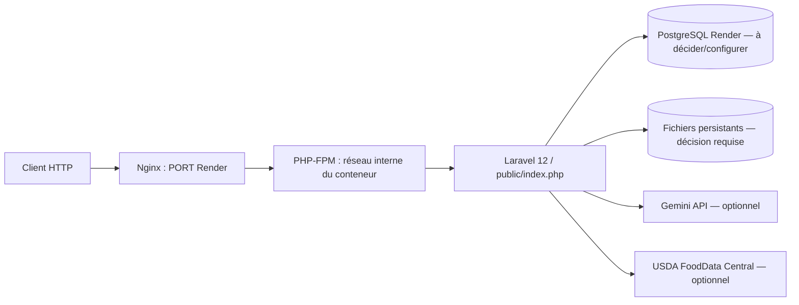

# Rapport DevOps NutriTrace — validation locale et préparation Render

Date de l’audit : 23 octobre 2026
Branche : `main` — HEAD : `f11f826`
État de publication : un commit local en avance sur `origin/main`; aucun push ni déploiement effectué.

## 1. Contexte et objectif

NutriTrace est une application Laravel 12 (PHP `^8.2`) avec ressources Vite, plusieurs modules métier, des intégrations Gemini et USDA, ainsi que des téléversements de fichiers. Cette phase vérifie l’image Docker déjà construite, exécute des validations locales, ajoute un pipeline CI et évalue la compatibilité PostgreSQL et les contraintes d’hébergement Render.

## 2. Architecture vérifiée



Dans l’image inspectée, Nginx et PHP-FPM sont gérés par Supervisor. Seul le port HTTP Nginx a été publié en local; le port FPM 9000 n’a pas été exposé à l’hôte. Le point d’entrée sert le répertoire `public` de Laravel. Le démarrage ne lance ni migration ni seeder.

## 3. Docker : implémentation et vérifications

L’image existante `nutritrace-local:latest` a été inspectée sans la reconstruire : PHP 8.3.36, dépendances Composer et manifeste Vite présents, répertoires Laravel nécessaires inscriptibles. Les extensions attendues, notamment `pdo_pgsql` et `pdo_sqlite`, sont présentes. Les vérifications `php-fpm -tt` et `nginx -t` ont réussi. Le modèle Nginx écoute sur `PORT` (valeur locale par défaut 10000); Render demande que le serveur HTTP écoute sur `0.0.0.0:$PORT`.

Le contexte Docker exclut `.env`, `.git`, les dépendances locales, les bases SQLite locales, les journaux et les données temporaires. L’image contrôlée ne contenait ni `.env`, ni base SQLite de développement, ni `node_modules`. Le script d’entrée prépare la configuration du port et démarre Supervisor; il ne révèle pas de secret et ne lance aucune migration.

Le test HTTP local a utilisé un conteneur éphémère, une clé Laravel synthétique et une base SQLite temporaire vide, sans montage de l’environnement ou de la base de l’hôte :

| Vérification | Résultat |
|---|---|
| Démarrage Supervisor, Nginx et PHP-FPM | PASS |
| `GET /up` | HTTP 200 |
| `GET /` | HTTP 200 |
| Manifeste Vite et fichier CSS | HTTP 200 |
| `GET /catalogue` avec le fichier SQLite absent ou sans schéma | HTTP 500 pendant le diagnostic initial |

Le journal Laravel a identifié le premier défaut de configuration : le chemin SQLite temporaire indiqué à l’application n’existait pas. Après création d’un fichier vide, `/catalogue` échouait encore tant que le schéma n’était pas migré. Après application des migrations existantes au fichier SQLite jetable, `/catalogue` a répondu HTTP 200 et affiché son état vide. La cause était donc le smoke test non initialisé, pas un défaut du contrôleur catalogue. Aucun code métier n’a été modifié.

### Validation Phase 2 — SQLite et PostgreSQL

Un conteneur séparé a utilisé une base PostgreSQL 18.6 vierge, privée sur un réseau Docker temporaire et stockée sur tmpfs, sans port de base exposé. Les **22 migrations existantes** ont réussi. Une catégorie et un produit synthétiques ont été insérés uniquement dans cette base jetable :

| Vérification PostgreSQL | Résultat |
|---|---|
| `GET /up` et `/` | HTTP 200 |
| `GET /catalogue` | HTTP 200; produit de test visible |
| Filtre `GET /catalogue?category=1` | HTTP 200; produit filtré visible |
| `GET /catalogue/phase-2-temporary-product` | HTTP 200; détail visible |
| Tables `products`, `categories`, `nutritional_analyses` | 1, 1, 0 enregistrements |
| `php artisan migrate:status` | migrations déclarées exécutées |

Le test démontre les lectures catalogue, la relation catégorie, le filtre et le détail sur PostgreSQL. Il ne constitue pas une exécution de la suite PHPUnit avec PostgreSQL, ni un test complet de toutes les relations, écritures ou modules. Les conteneurs et le réseau temporaires ont été nettoyés après le test.

Nginx a aussi répondu HTTP 200 pour `/build/manifest.json` et `/build/assets/bootstrap-datepicker-JWzVzq5B.css`.

## 4. CI GitHub Actions

Le fichier `.github/workflows/ci.yml` définit une validation sur les pull requests vers `main` et les pushs vers `main`. Il installe PHP 8.3 et Node 22, valide Composer, installe les dépendances verrouillées, vérifie que PHPUnit cible SQLite en mémoire, construit les assets Vite puis exécute les tests Laravel. Les permissions sont `contents: read`, checkout n’enregistre pas ses identifiants (`persist-credentials: false`), et aucune étape de déploiement n’est présente.

La syntaxe et la structure YAML ont été vérifiées localement avec Symfony YAML, y compris les déclencheurs, le job et la permission en lecture seule. L’audit Phase 3 a trouvé une référence PHP invalide/non publiée : `shivammathur/setup-php@2.40.0` pointait vers une version stable qui n’existait pas dans les releases disponibles (2.40.0 était en bêta). Elle a été remplacée par la release stable vérifiée `2.37.2`. Les releases checkout `v7.0.1` et setup-node `v7.1.0` sont également publiées.

Le travail CI ne reçoit aucune clé externe : `APP_KEY` est générée aléatoirement pour le job, et les variables DB forcent SQLite `:memory:` avec `DB_URL` vide. La configuration PHPUnit est contrôlée avant les tests. `composer install` et `npm ci` utilisent les lockfiles, sans mise à jour; le cache Composer et le cache npm sont configurés avec leurs fichiers de verrouillage. Aucun cache de configuration Laravel n’est généré, donc aucune purge n’est requise sur un runner neuf. Le workflow n’a pas été publié ni exécuté sur GitHub : aucun succès distant n’est revendiqué. Après publication autorisée, ses résultats seront visibles dans l’onglet **Actions** du dépôt.

## 5. Tests et qualité

| Commande ou contrôle | Résultat réel |
|---|---|
| `composer validate --no-check-publish` | PASS — `composer.json` valide |
| `composer install --dry-run --no-interaction --prefer-dist --no-progress` | PASS — lockfile et exigences de plateforme vérifiés; rien à installer. Cache local non accessible et Packagist injoignable dans le sandbox, donc cette exécution n’a pas retéléchargé les paquets |
| `npm ci --dry-run --no-audit --no-fund` | PASS — lockfile cohérent, « up to date »; aucun paquet installé ni lockfile écrit |
| `php artisan test --compact` (Phase 3, environnement isolé explicite) | PASS — 163 tests, 1 336 assertions, 16,11 s; SQLite `:memory:` |
| `npm run build` (Phase 3) | PASS — Vite 7.3.7; avertissement non bloquant pour le chunk vide `images` |
| Vérification XML de `phpunit.xml` | PASS — SQLite `:memory:` |
| Vérification YAML et assertions de structure | PASS — parseur Symfony YAML; branches PR/push, job et permissions vérifiés |
| `php-fpm -tt` | PASS |
| `nginx -t` | PASS |
| `git diff --check` | PASS |

L’exécution locale utilise PHP 8.5.11 et Node 22.22.0; le workflow cible PHP 8.3 et Node 22. Le test a été forcé vers un environnement local synthétique et la base mémoire, sans afficher de secret. Le build Vite a nécessité une exécution hors du sandbox de fichiers, car esbuild était bloqué dans le répertoire parent sous sandbox. `composer install` et `npm ci` réels n’ont pas été lancés localement : seuls leurs dry-runs ont été utilisés afin de ne pas remplacer le `vendor` ou `node_modules` existant. L’installation fraîche, les versions exactes configurées par les actions et l’exécution GitHub restent donc **NOT YET VALIDATED REMOTELY**.

Le build Vite produit un chunk JavaScript `images` vide. L’entrée correspond à `resources/assets/js/images.js`, incluse par le layout, dont le rôle documenté est d’inclure les images de template dans le manifeste via `import.meta.glob`. Le manifeste de build contient 22 entrées d’images et un asset CSS a été servi en HTTP 200. Aucun défaut fonctionnel n’a été établi; l’avertissement n’a pas été masqué ni corrigé artificiellement.

SonarQube n’a pas été exécuté : aucune configuration de projet ou adresse de serveur applicable n’a été trouvée. Tests, analyse statique, couverture et analyse de vulnérabilités des dépendances sont des contrôles distincts; aucun score Sonar ni résultat d’analyse de vulnérabilités n’est revendiqué.

## 6. Compatibilité PostgreSQL

Les migrations existantes ont été appliquées avec succès à une base PostgreSQL 18 vierge dans un conteneur temporaire isolé : **22 migrations réussies**. Le conteneur utilisait un stockage temporaire en mémoire, sans port publié, données de production ou migration de production. Les migrations et recherches SQL examinées n’ont pas révélé d’hypothèse SQLite bloquante dans ce contrôle.

Cette vérification confirme la création du schéma sur PostgreSQL 18; elle ne remplace pas une suite complète de tests fonctionnels contre PostgreSQL. Les tests Laravel du projet continuent d’utiliser SQLite en mémoire. La configuration Laravel lit l’URL de connexion PostgreSQL via `DB_URL` et sélectionne le pilote par `DB_CONNECTION=pgsql`; ne pas supposer que le nom `DATABASE_URL` du guide Render sera consommé automatiquement par cette application.

Plan avant migration de production : choisir/créer la base, sauvegarder et vérifier la sauvegarde, contrôler la version et la connectivité, relire la liste des migrations en attente, tester sur une copie, exécuter uniquement les migrations approuvées dans une étape distincte, vérifier les données et préparer un retour arrière/restauration. Rien de cette procédure n’a été exécuté en production.

## 7. Fichiers et stockage

Les contrôleurs écrivent explicitement les images produits et documents de certification sur le disque Laravel `public` (`storage/app/public`). Les images catalogue et documents de certification sont ensuite lus depuis ce disque. Sur un système de fichiers Render éphémère, ces fichiers locaux peuvent disparaître lors d’un redémarrage ou déploiement. La base de données ne remplace pas ces fichiers.

Deux choix restent ouverts :

1. Un disque persistant Render monté sur `/var/www/html/storage/app/public` préserverait ces uploads, mais il s’agit d’une option payante et attachée à une seule instance; les disques limitent aussi les déploiements sans interruption. Le tarif affiché par Render au moment de la consultation est de 0,25 USD/Go/mois.
2. Un stockage objet nécessite une adaptation/configuration : bien que le disque S3 soit déclaré, les contrôleurs ciblés utilisent explicitement `disk('public')`; définir seulement `FILESYSTEM_DISK=s3` ne redirigerait donc pas ces opérations.

La base, les uploads et leur stratégie de sauvegarde doivent être décidés avant une utilisation réelle. Les services gratuits Render ont un système de fichiers éphémère; le Postgres gratuit est limité à 1 Go et expire après 30 jours, donc il ne convient pas à une conservation de production.

## 8. Paramètres Laravel et sécurité de déploiement

À fournir dans les paramètres secrets du service Render, jamais dans l’image ou Git :

- `APP_KEY` (générée pour l’environnement de déploiement), `APP_ENV=production`, `APP_DEBUG=false`, `APP_URL` HTTPS.
- `DB_CONNECTION=pgsql` et `DB_URL` avec l’URL interne Render, ainsi que les paramètres requis par la configuration du service.
- Choix explicite de `SESSION_DRIVER`, `CACHE_STORE`, `QUEUE_CONNECTION`, `LOG_CHANNEL` et `FILESYSTEM_DISK`. Les valeurs Laravel par défaut actuelles pour session/cache/queue sont basées sur la base de données; il faut les conserver avec les tables disponibles ou choisir et tester d’autres pilotes.
- Courriel : `MAIL_MAILER`, `MAIL_HOST`, `MAIL_PORT`, `MAIL_USERNAME`, `MAIL_PASSWORD`, `MAIL_FROM_ADDRESS` et paramètres TLS correspondants si la vérification d’adresse est utilisée.
- Intégrations optionnelles : `GEMINI_API_KEY`, `GEMINI_VISION_MODEL`, `USDA_API_KEY` et URL de tuiles OSM si nécessaire.

Le modèle `User` implémente `MustVerifyEmail`; les flux de vérification sont déclarés. Un transport mail opérationnel est donc nécessaire pour la vérification et les notifications. Aucun travail en arrière-plan via `ShouldQueue`, dispatch de job ou planification n’a été repéré dans le code audité; la commande `NutriAI` envoie un courriel directement.

Point à résoudre avant production : `bootstrap/app.php` n’explicite pas les proxies de confiance. Render termine TLS en amont et transmet HTTP au conteneur; les en-têtes transmis doivent être traités de manière sûre pour que Laravel génère les URL HTTPS et applique les cookies sécurisés correctement. Ce changement de code n’a pas été fait dans cette phase.

Autres réglages à vérifier lors de la création du service : health check `/up`, exposition de `PORT` à Nginx, limites de ressources, logs vers stderr, CORS/CSRF, rate limiting et comportement des APIs en cas de clé absente ou quota atteint. Les noms de variables ci-dessus sont des noms seulement; aucune valeur secrète n’est incluse dans ce rapport.

## 9. Schéma de déploiement et plan de migration

```mermaid
sequenceDiagram
    participant GH as GitHub deployment branch
    participant CI as GitHub Actions
    participant R as Render build/deploy
    participant PG as Render PostgreSQL
    GH->>CI: PR/push (après publication)
    CI->>CI: Composer + npm ci + Vite + tests SQLite mémoire
    GH->>R: push to linked Render branch (Auto-Deploy setting to confirm)
    R->>R: build image; entrypoint waits for PostgreSQL, migrates, starts Nginx/PHP-FPM
    R->>PG: connexion via DB_URL
    Note over R,PG: migrations run at startup; abort if PostgreSQL is unavailable or migration fails
```

Cette description est un instantané historique et ne décrit plus le démarrage au HEAD `5d3b4a4`. Actuellement, `docker/entrypoint.sh` attend PostgreSQL avec un nombre borné de tentatives, exécute `php artisan migrate --database=pgsql --force --no-interaction`, puis configure Nginx et lance Supervisor. Si PostgreSQL reste indisponible ou si les migrations échouent, le conteneur s’arrête avant le démarrage des services web. Aucun pré-déploiement Render ni lancement concurrent de migrations n’est ajouté par la phase 3.

## 10. Statut, coûts et limites

| Élément | Statut |
|---|---|
| Docker, smoke tests HTTP et assets | IMPLEMENTED AND VERIFIED — endpoints, catalogue, détail et CSS testés localement |
| Tests Laravel / Composer / build Vite | IMPLEMENTED AND VERIFIED — résultats consignés ci-dessus |
| Workflow GitHub Actions | IMPLEMENTED BUT NOT REMOTELY VERIFIED — YAML et commandes locales vérifiés; non publié, aucune exécution distante |
| PostgreSQL 18 migrations et catalogue ciblé | IMPLEMENTED AND VERIFIED — 22 migrations et lectures ciblées; suite PHPUnit PostgreSQL NOT TESTED |
| SonarQube | NOT IMPLEMENTED — non configuré et non exécuté |
| Render Web Service / PostgreSQL / disque | BLOCKED — choix d’offre, persistance et approbation requis; aucun service créé |
| Déploiement, URL publique, HTTPS et tests de production | NOT IMPLEMENTED — aucun déploiement autorisé ou effectué |
| Captures d’écran de production | NOT TESTED — à prendre après un déploiement autorisé |

Les tarifs et limites évoluent. La page de tarification Render consultée indique 0,25 USD/Go/mois pour un disque persistant; les prix de calcul et PostgreSQL doivent être confirmés dans le tableau de bord avant toute création. Le niveau gratuit est destiné à l’évaluation, pas à une base de production durable. Le coût total dépend du plan Web, PostgreSQL, stockage, bande passante et pipeline.

## 11. Captures à réaliser ultérieurement

Après autorisation et déploiement seulement : pipeline GitHub Actions réussi; configuration du service (sans valeurs secrètes); statut Render et health check; page d’accueil et catalogue avec PostgreSQL; flux d’inscription/vérification; fonctionnalités avec téléversement après redémarrage; logs expurgés; URL HTTPS et assets sans contenu mixte.

## 12. Conclusion

Les éléments locaux nécessaires à une démonstration sont vérifiés : image démarrable, endpoint health, assets accessibles, tests PHP et build Vite réussis, migrations appliquées sur PostgreSQL 18 temporaire. Avant toute mise en production, il reste à publier le workflow après approbation, choisir les offres payantes ou limites acceptables, configurer PostgreSQL et la persistance des uploads, corriger/vérifier la confiance proxy HTTPS, saisir les secrets dans Render et valider la stratégie de migrations. Aucun push, service Render, coût, migration de production ou smoke test public n’a été effectué.

## Phase 3 — état courant au HEAD `5d3b4a4`

Cette section décrit la configuration vérifiée pour la phase 3. Les chiffres et validations des sections précédentes sont des résultats historiques de leurs dates respectives et ne sont pas réaffirmés ici.

### CI GitHub Actions

Le workflow existant `.github/workflows/ci.yml` est étendu, sans second workflow. Il se déclenche pour les pull requests vers `main` et les pushes vers `main` ou `feature/**`. Il conserve Composer, Node 22, `npm ci --ignore-scripts`, le build Vite et PHPUnit avec SQLite `:memory:`; les pilotes cache/session/queue restent isolés et aucun secret de production n’est requis. Les actions sont épinglées sur leurs SHA complets, le jeton checkout n’est pas persisté et les permissions restent limitées à `contents: read`.

Le job ajoute `php -l` sur le code PHP du projet (hors `vendor` et `bootstrap/cache`), `git diff --check` sur le patch poussé ou la diff de PR et une construction locale de l’image Docker. Cette construction ne pousse aucune image et ne déploie pas l’application. Le workflow n’a pas été exécuté sur GitHub dans cette phase; ses résultats locaux sont rapportés séparément.

### Runtime et observabilité Render

L’architecture demeure une image multi-stage avec Nginx, PHP-FPM et Supervisor. L’entrypoint effectue la vérification PostgreSQL bornée, applique les migrations en mode `--force`, puis lance Nginx/PHP-FPM via Supervisor. Aucun changement de privilèges, de migrations, de déploiement, de persistance ou de variables Render n’est effectué ici.

Render doit utiliser le health-check path `/up`, fourni par Laravel dans `bootstrap/app.php`; aucune route de santé supplémentaire n’est nécessaire. Le service public n’a pas été sollicité dans cette phase, donc l’endpoint en production n’est pas vérifié. Configurer manuellement dans Render `LOG_CHANNEL=stderr` pour envoyer les journaux Laravel vers stderr et `APP_DEBUG=false` en production; aucune variable d’environnement Render n’a été changée. Consulter les logs de build et de runtime, l’état du health check, les métriques CPU/mémoire/requêtes disponibles selon le plan et activer les notifications Render de déploiement en échec ou service unhealthy. Un moniteur externe gratuit à intervalle limité peut surveiller `/up`, sans être une dépendance de l’application.

### Déploiement

Aucun workflow de déploiement supplémentaire n’est créé et aucun déploiement n’est déclenché. La branche actuellement liée au service Render doit être confirmée dans le tableau de bord avant toute publication; Auto-Deploy peut être configuré manuellement pour attendre les vérifications CI réussies si l’option est prise en charge pour le service et son plan. La branche de déploiement, les références Git et le suivi local ne sont pas modifiés.

### Validation locale de la phase

Validé localement : parsing YAML/structure du workflow (Symfony YAML), `composer validate --no-check-publish` (code 0), `php -l` sur 173 fichiers PHP (code 0), `php artisan test --compact` (163 tests, 1 336 assertions, code 0), `npm run build` (code 0), `docker info` (serveur disponible, code 0), `docker build --tag nutritrace-ci:phase3 .` (code 0) et `git diff --check` (code 0). Le PHPUnit XML a été vérifié : `DB_CONNECTION=sqlite`, `DB_DATABASE=:memory:`, `DB_URL` vide, cache/session en mémoire et queue synchrone; les variables DB du processus PowerShell étaient absentes. Pas de migration ni seed exécuté.

Non validé à distance : le workflow GitHub n’a pas été déclenché/exécuté sur GitHub, l’endpoint Render `/up` n’a pas été appelé, et aucun déploiement ou réglage du tableau de bord Render n’a été effectué.

## Références Render consultées

- [Déployer Laravel avec Docker](https://render.com/docs/deploy-php-laravel-docker)
- [Web Services et ports](https://render.com/docs/web-services)
- [Systèmes de fichiers gratuits et limites](https://render.com/docs/free)
- [Disques persistants](https://render.com/docs/disks)
- [Commandes de déploiement et pré-déploiement](https://render.com/docs/deploys)
- [Versions PostgreSQL prises en charge](https://render.com/docs/postgresql-upgrading)
- [Tarification Render](https://render.com/pricing)
